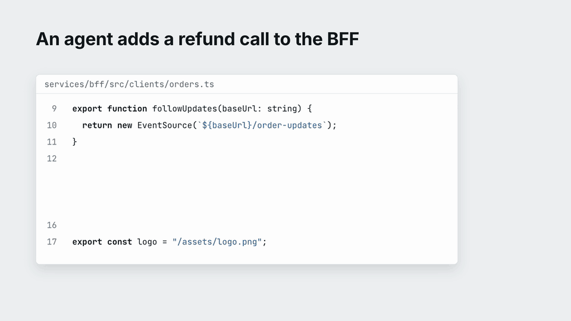

# flow-atlas

**Check that the services in a monorepo still fit together, while the code is being written.**

flow-atlas reads the routes each service registers and the requests each client sends, and checks a change against the
other services. No LLM is involved: the same code always gives the same findings.

It is built for coding agents. An agent works on one part of a repository at a time, so it easily builds the client
and forgets the service, adds a second API that does what an existing one does, or puts one service's job into another.
flow-atlas shows those gaps while the agent works, instead of in a later review.



Recorded on [`fixtures/shop`](fixtures/shop), the sample monorepo in this repository ([MP4](docs/media/demo.mp4)). To
run the check on it yourself:

```bash
git clone https://github.com/hellices/flow-atlas && cd flow-atlas
npx github:hellices/flow-atlas check --root fixtures/shop
```

## Contents

- [What it finds](#what-it-finds)
- [Key terms](#key-terms)
- [What it reads](#what-it-reads)
- [Install](#install)
- [Use](#use)
- [Day to day](#day-to-day)
- [Use with a coding agent](#use-with-a-coding-agent)
- [Flows and output](#flows-and-output)
- [Limits](#limits)
- [Documentation](#documentation)
- [Contributing](#contributing)

## What it finds

| Finding | Example | Code in the output |
|---|---|---|
| An API nobody calls | `orders` serves `GET /orders/{id}/history`, and no client in the repository requests it | FA001 |
| A call nothing serves | the demo above | FA002 |
| A dependency that is not declared, or a cycle | `web` calls `orders` directly, but its `component.json` declares only that it uses `bff` | FA003 |
| A registry entry (an artifact, a tool or an event) with one side missing | a `coupon` document is produced, and nothing consumes it | FA004 |
| A written flow the code no longer follows | a flow names a route that was renamed, or two steps the code does not connect | FA007 |

The code is how a finding is named everywhere: in the output, in the exceptions file and in the configuration
(`rules.FA003.enabled: false` switches that check off). Causes and fixes for each:
[rules.md](skills/flow-atlas/references/rules.md).

## Key terms

| Term | Meaning |
|---|---|
| component | a service or app in the monorepo, such as `web`, `bff` or `orders` |
| surface | something a component serves: an HTTP route, most of the time (`orders\|GET /orders/{id}`) |
| call | a request one component sends to another (`bff -> orders  POST /orders`) |
| chain | one request and everything it reaches in turn |
| flow | a journey you describe in a file (`flows/*.flow.yaml`), built from chains, with what each component does in it |
| limit | a `limit:` line: something atlas saw but could not read for certain, so it left it out rather than guess |
| baseline | the findings you accepted as known debt; `check` shows only findings new since then |

## What it reads

| Language | Routes | Client calls |
|---|---|---|
| TypeScript, JavaScript | Express, Fastify, Koa (@koa/router), Hono, NestJS, Next.js | fetch, axios, Ky, openapi-fetch, RTK Query, Angular HttpClient, @hey-api/openapi-ts, orval |
| Python | FastAPI, Flask, Quart, Django and Django REST framework | Requests, HTTPX |
| Java, Kotlin | Spring MVC, Spring WebFlux, Spring Boot | RestTemplate, RestClient, WebClient, OkHttp, Retrofit, OpenFeign, Ktor client |
| C# | ASP.NET Core (minimal APIs and controllers) | HttpClient, Refit |
| Go | Gin, chi, net/http | net/http, resty |
| Dart, Swift | | package:http, dio, URLSession, Alamofire |
| Any | the OpenAPI 2.0 or 3.x document of any framework | links and forms in HTML templates, Thymeleaf included |

For each route and call, atlas also reads:

- **Paths as the framework writes them:** prefixes, mounts, groups and routers. Each path is read in its router's
  syntax, at the version the project depends on.
- **Methods as the library sets them:** `.get(...)`, annotations, builder chains, or a method passed with the URL.
- **URLs as the code builds them:** template strings, `+`, formatting and URL builders, joined to the client's base
  URL by the library's own rule.
- **Which route a request reaches,** as the framework dispatches it: registration order, router precedence, and how
  it treats a trailing `/`.
- **What a route's handler calls next,** through functions, imports and ports and adapters (TypeScript and
  JavaScript), and the links and forms a Spring or Next.js page renders.

atlas reads only what the code states for certain, with the meaning the framework's documentation or source gives it,
and guesses nothing. What it cannot read is a `limit:` line or, where it cannot see it at all, one of the
[limits](#limits) below.

Every rule, per framework and library: [config.md](skills/flow-atlas/references/config.md#what-the-extractors-read).
How atlas reads each framework and client library is measured against the framework itself in
[`fixtures/frameworks`](fixtures/frameworks/README.md) and [`fixtures/clients`](fixtures/clients/README.md).

<details>
<summary>Which style to pick for a framework</summary>

- **Spring:** read its annotations (`styles: [spring]`) and give atlas springdoc's document as well. Routes keep their
  controller lines and take the document's operationIds.
- **Flask or Quart:** read its code (`styles: [flask]`). Where it uses flask-smorest or flasgger, give atlas the
  document it generates too; flask-smorest's own `Blueprint` is read from that document only.
- **Django:** read its URLconfs (`styles: [django]`) from the settings module that sets `ROOT_URLCONF`. Django REST
  framework is included. The admin site's patterns are left out with a limit.
- **Go on Gin, chi or net/http:** read its code (`styles: [go]`).
- **Django Ninja and the rest:** give atlas the OpenAPI document the framework generates. atlas finds each operation's
  handler by its operationId where it can. [`fixtures/openapi`](fixtures/openapi/README.md) holds eight documents that
  seven frameworks generate, and [openapi.md](skills/flow-atlas/references/openapi.md) shows how to produce one
  without serving it.

</details>

## Install

Requires Node.js 20 or later.

```bash
npx github:hellices/flow-atlas --help        # run without installing; prepare builds it on install
npm install -g github:hellices/flow-atlas    # install the atlas command
```

Recent npm versions may ask before running install scripts. If `prepare` is blocked, install the packed release
instead (`npm install -g <flow-atlas-x.y.z.tgz URL>`).

## Use

Start from what atlas finds, write the configuration, then scan until it reads what it should:

1. `atlas inventory --root <repo>` lists candidate components, routes and client calls. It writes nothing.
2. Write `atlas.config.yaml` at the repository root (or in `--out`, for a repository you must not change) from that
   list: the components, where each serves routes, and which files call others.
   [config.md](skills/flow-atlas/references/config.md) describes every key.
3. `atlas scan --root <repo>` prints what each configured source yielded. Correct the configuration and scan again;
   expect two or three rounds before the findings are worth trusting.
4. `atlas check --root <repo>` prints the findings.

<details>
<summary>All commands</summary>

```bash
atlas inventory --root <repo>                 # candidate components, routes, client calls
atlas scan --root <repo>                      # what each configured source yielded
atlas query --path /orders                    # surfaces and calls by path or component
atlas trace "bff|GET /screens/order/{id}"     # callers upstream and services downstream
atlas chains --unnamed                        # each request and everything it reaches, that no flow names yet
atlas draft flows                             # a flow draft per such chain; only the author's fields are left
atlas flows                                   # flow descriptions held against the code
atlas check --root <repo>                     # findings new since the baseline
atlas check --since main                      # findings the current change introduced
atlas check --format sarif > atlas.sarif      # findings as SARIF 2.1.0 (code scanning, IDE viewers)
atlas diff main..WORKTREE --format markdown   # flow changes and new findings for a PR description
atlas export arazzo > flows.arazzo.yaml       # flows as Arazzo 1.0 (stdout; keep it at the repository root)
atlas explain <key>                           # one finding with nearby paths
atlas baseline update                         # accept the current findings as known debt
```

</details>

- **Reading without touching the repository.** `--ref <commit>` reads a commit without checking it out, and every
  write goes to `--out` (`export` prints to stdout). A repository you must not change can be analysed with `--out`
  outside it.
- **Exit codes.** Every command exits 0 when it is done and 2 on an error. `check --fail-on-new` exits 1 when there are
  new findings. `export arazzo` exits 1 when there is nothing to export: no active flow, none of the name `--flow`
  gives, or no step an OpenAPI description names.
- **Reading a trace.** How `trace` joins calls to routes and handlers to calls: [docs/traces.md](docs/traces.md).

## Day to day

1. **Record the debt.** Once the configuration reads what it should, run `atlas baseline update`. From then on only new
   findings appear. Existing debt is reduced on its own schedule, and each change answers only for what it introduced.
2. **Handle each new finding.**
   - Fix it, or record it in the exceptions file (`flows/atlas-exceptions.yaml`) with the decision behind it and a
     date to look again. When the date passes, the finding comes back.
   - A wrong finding caused by the configuration is fixed there. A misread file is recorded as an exception that says
     which file was misread and how.
   - A rule that is mostly wrong for a repository is switched off there (`rules.<id>.enabled: false`), or its extractor
     is fixed.
3. **Decide whether CI blocks.** atlas reports and does not block by default. To fail CI on new findings, add
   `--fail-on-new`.

## Use with a coding agent

The [agent skill](skills/flow-atlas/SKILL.md) teaches an agent when to run atlas (before it adds a route or a call, and
before it opens a PR) and how to treat what it finds. It is the [`skills/flow-atlas`](skills/flow-atlas) directory
and follows the [Agent Skills](https://agentskills.io) specification, so GitHub Copilot, Claude Code, Codex, Cursor
and other hosts load it the same way. With GitHub CLI 2.90 or later:

```bash
gh skill install hellices/flow-atlas flow-atlas
```

Or copy the directory into your host's skills directory (for example `.github/skills/` or `.agents/skills/`).

### Who does what

| Who | Writes |
|---|---|
| atlas | what the code settles: routes, calls, how they connect, operationIds, OpenAPI descriptions and how far they agree with the code, flow traces, flow drafts, and the findings |
| an agent or a person | what needs intent: a flow's title, what each component does in it, its owner, whether a step is planned, why a finding is an accepted exception. atlas checks that these are written and still hold |
| the skill | the criteria for judgments in between: whether a hop belongs to the component it sits in, and whether a gap is a defect, a plan or a false positive |

More in [docs/responsibilities.md](docs/responsibilities.md).

## Flows and output

- **Flows.** A flow is written in `flows/*.flow.yaml` as a Kubernetes-style object (`apiVersion`, `kind: Flow`,
  `metadata`, `spec`), with Arazzo-style steps. Each step names one of the repository's own routes or calls and the
  role its component plays, and `sources` names the decisions behind the flow. `atlas flows` reports
  Kubernetes-style conditions for each flow (`Ready`, `Resolved`, `Connected`, `ProducesListed`, `Documented`). A flow
  file is reviewed like code, in the pull request that changes it.
- **Output.** Everything printed with `--format json` or `--format yaml` follows the JSON Schemas in [`schema/`](schema),
  with `apiVersion`, `kind` and an SLSA-shaped `provenance` (the commit and files read, with digests). There are no
  timestamps, so the same inputs give the same document. Route paths are OpenAPI path templates (`{id}`).
- **Standards.** `check --format sarif` prints findings as SARIF 2.1.0, and `export arazzo` prints the flows as an
  Arazzo 1.0 description. The flow files themselves follow the project's own Kubernetes-style schema, with Arazzo-style
  steps; they are not Arazzo documents. Why each field is there: [docs/schema.md](docs/schema.md) and
  [docs/standards.md](docs/standards.md).

## Limits

- **Only what is written out is read.** A path assembled across several functions, or a URL taken from a server
  response, is not seen, and the route it calls shows up as an API nobody calls (FA001). Such a URL leaves no `limit:`
  line either, so no limit does not prove that everything was read.
- **Some calls are named, not read.** These are not read as calls, and a `limit:` line names each:
  - a path handed to a function after its first argument;
  - an absolute URL to a host that is neither a loopback address nor the target's `origins` entry;
  - a path given to an exception in code read as text.
- **Prefixes are applied, not read as requests.** The text a helper puts before the path it is given (the configured
  base, or a module helper's `` `/api${path}` ``) is applied to the paths passed to the helper.
- **An unread base leaves its calls out.** A request through a client whose base, interceptor or hook atlas does not
  read is left out and named in a limit. Set the call source's `base` and `join` (or `prefix`) where the code holds the
  base in a value.
- **Only configured files are read,** so no finding does not prove a flow complete.
- **Field-level contract checks** are not implemented yet.

## Documentation

| Document | What it covers |
|---|---|
| [SKILL.md](skills/flow-atlas/SKILL.md) | how an agent uses atlas |
| [config.md](skills/flow-atlas/references/config.md) | the configuration, and every rule the extractors follow |
| [rules.md](skills/flow-atlas/references/rules.md) | each finding's causes and fixes |
| [boundaries.md](skills/flow-atlas/references/boundaries.md) | judging whether a hop belongs to its component |
| [openapi.md](skills/flow-atlas/references/openapi.md) | producing and reading OpenAPI documents |
| [docs/traces.md](docs/traces.md) | how traces connect calls, routes and handlers |
| [docs/direction.md](docs/direction.md) | the scope, the research it rests on, and the extensions left open |
| [docs/responsibilities.md](docs/responsibilities.md) | what atlas, agents and people each decide |
| [docs/schema.md](docs/schema.md), [docs/standards.md](docs/standards.md) | the output formats and the standards they follow |

## Contributing

Building, testing, the hooks and the fixtures that check atlas against real frameworks: [CONTRIBUTING.md](CONTRIBUTING.md).

## License

MIT. The official schemas under `test/standards/` are third-party material under their publishers' terms.
